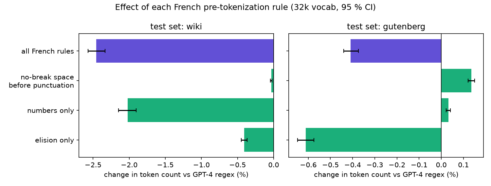
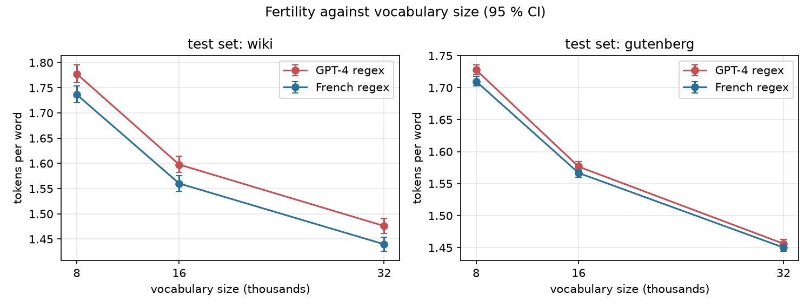
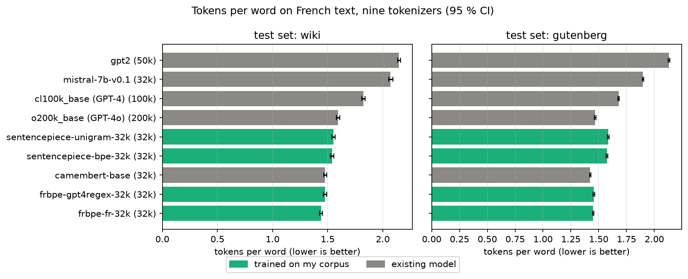
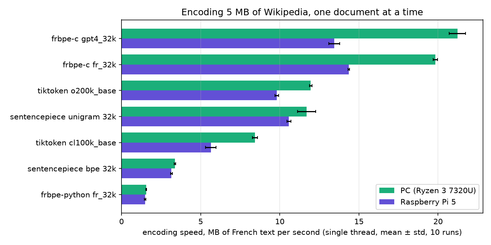
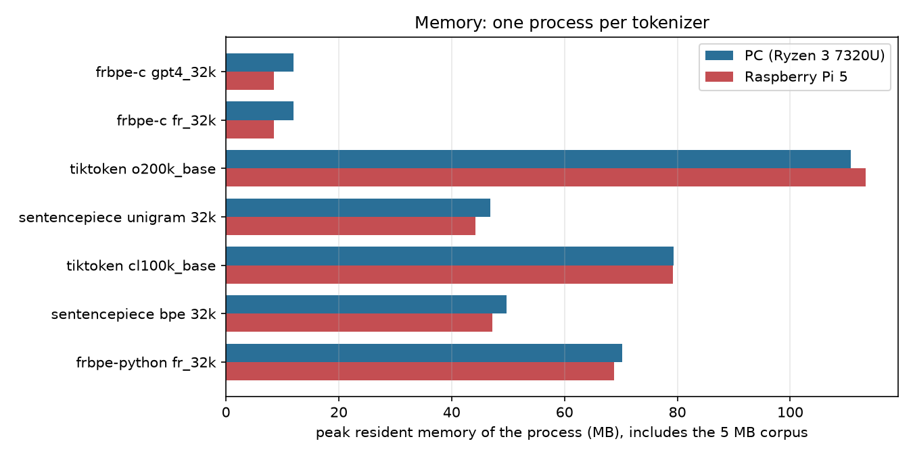
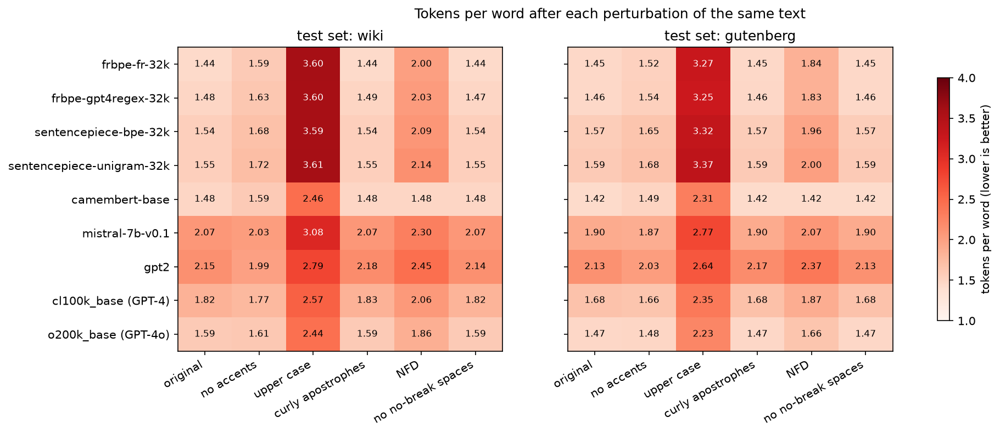

# french-bpe-tokenizer

A byte-level BPE tokenizer that I am writing from scratch, trained on French text,
and measured against the tokenizers of large models (tiktoken, SentencePiece).

Work in progress. This README grows with each milestone; for now it only covers
the data.

## Data

| Split | Source | Documents | Text size |
|---|---|---|---|
| `train_wiki` | French Wikipedia, 2023-11-01 dump, one shard | 36,938 articles | 100.0 MB |
| `test_wiki` | Same shard, held-out articles | 1,989 articles | 5.0 MB |
| `test_gutenberg` | 8 French novels from Project Gutenberg | 351 chunks of ~20k chars | 7.1 MB |

Nothing under `data/` is committed. Two commands rebuild it, and every
downloaded file is checked against a SHA-256 digest:

```bash
python scripts/download_data.py    # ~176 MB
python scripts/prepare_corpus.py   # writes data/processed/*.jsonl + MANIFEST.json
```

A few choices I made, and why:

- **The split is done per article**, using a hash of the article id. Splitting per
  line would put sentences of one article on both sides and make the test set
  look easier than it really is.
- **Text is NFC-normalised.** Otherwise "é" can be stored as one code point or as
  "e" + a combining accent, and the tokenizer would waste vocabulary learning
  both. How each tokenizer copes with NFD input is a separate experiment.
- **The novels are a second test set from another domain.** Training only on
  Wikipedia and testing only on Wikipedia would tell me nothing about how the
  tokenizer behaves on other kinds of French.
- **Gutenberg line breaks are removed inside paragraphs.** The files are wrapped
  at about 70 columns; keeping that would mostly measure newlines.

Known limitations of the data:

- The Hugging Face Wikipedia dump drops the content of templates. Dates and
  some numbers disappear, which leaves sentences like "sa quille est posée le
  par …". It slightly under-represents numbers.
- One shard is not a uniform sample of French Wikipedia; shards follow the
  order of article ids.
- The novels keep their table of contents.

Sources and licences:

- Wikipedia: [`wikimedia/wikipedia`](https://huggingface.co/datasets/wikimedia/wikipedia),
  revision `b04c8d1`, CC BY-SA 3.0 / GFDL.
- Project Gutenberg books 17489, 14155, 5711, 17989, 19657, 798, 4791, 13951
  (Hugo, Flaubert, Zola, Dumas, Stendhal, Verne), public domain.

## The tokenizer (milestone 1)

`src/frbpe/bpe.py` is a byte-level BPE in plain Python: the 256 byte values
are the base vocabulary, so any UTF-8 text can be encoded and nothing is ever
"unknown". Before BPE runs, a regex cuts the text into chunks
(`src/frbpe/pretokenize.py`). For now it is the GPT-4 (`cl100k_base`) pattern,
copied from tiktoken.

```bash
python scripts/train_tokenizer.py --vocab-size 32000 --pattern gpt4
```

```python
from frbpe.bpe import BPETokenizer

tok = BPETokenizer.load("models/gpt4_32k.bpe")
ids = tok.encode("Les élèves mangeaient des pommes.")
assert tok.decode(ids) == "Les élèves mangeaient des pommes."
```

How training stays fast enough in Python: chunks are counted once
(`" maison"` → number of occurrences), then BPE works on the table of unique
chunks. Pair counts are updated only for the chunks touched by each merge, and
the most frequent pair comes from a heap with lazy invalidation. A test checks
that this gives exactly the same merges as a naive version that recounts
everything after each merge.

Ties between pairs with the same count are broken by taking the smallest pair
of ids. Without a fixed rule, two runs could learn different vocabularies.

What I measured so far (one machine, AMD Ryzen, Python 3.12, single process):

| Check | Result |
|---|---|
| Training, 32k vocab, 100 MB of Wikipedia | 148.8 s and 142.3 s (2 runs) |
| Same merges file on both runs | yes, identical SHA-256 |
| `decode(encode(x)) == x` on all 2,340 test documents | 0 failures |

Only 31,744 merges are learned for a 32k vocabulary: 256 ids are the raw bytes.

The first thing the trained model shows is the problem the next milestone deals
with. With the GPT-4 regex, the apostrophe of a French elision is glued to the
*next* word:

```
L | 'école |  d | 'été |  est |  aujourd | 'hui |  fermée | .
```

So `'école`, `'été` and `'hui` become tokens of their own, and the same word
gets a different token depending on what precedes it (`école` vs `'école`).

## Does a French regex help? (milestone 2)

I wrote three French rules (`src/frbpe/pretokenize.py`), each replacing one
piece of the GPT-4 pattern:

| Rule | GPT-4 regex | French regex |
|---|---|---|
| elision | `L` `'école` | `L'` `école` |
| numbers | `1` `␣` `000` | `1` `␣000` |
| no-break space before `: ; ! ?` | `Prix` `⍽` `:` | `Prix` `⍽:` |

Then I trained one tokenizer per rule, plus one with all of them, all on the
same 100 MB of Wikipedia at 32k, and compared token counts on the two test
sets. The comparison is paired: same documents for both tokenizers, and a
bootstrap over documents (1000 resamples) for the 95 % interval.



| Change in token count vs GPT-4 regex, 32k | Wikipedia (test) | Novels (Gutenberg) |
|---|---|---|
| elision only | −0.41 % [−0.45, −0.37] | −0.61 % [−0.65, −0.57] |
| numbers only | −2.02 % [−2.15, −1.90] | +0.03 % [+0.02, +0.04] |
| no-break space only | −0.03 % [−0.04, −0.02] | +0.14 % [+0.12, +0.15] |
| **all French rules** | **−2.45 % [−2.57, −2.33]** | **−0.41 % [−0.44, −0.37]** |

The honest summary: the French regex helps, the effect is real (every
interval is far from zero), but it is small. I expected more from the elision
rule. Here is what I understand of the numbers:

- **Numbers carry most of the gain on Wikipedia.** GPT-4 spends a whole token
  on the space before each number (`le` `␣` `14`). Wikipedia is full of dates,
  the novels are not, so the rule does nothing there.
- **Elision matters more in novels**, which have more dialogue and more
  `qu'`, `j'`, `n'`. It is still below 1 %, because BPE copes with the GPT-4
  split on its own: it simply learns `'école` as an extra token. I counted
  them: the GPT-4 32k vocabulary has **1,384 tokens that start with an
  apostrophe**, the French one has 10. The French regex frees those slots, but
  they go to rarer words, which do not save much.
- **The no-break space rule makes the novels slightly worse.** The novels
  contain no no-break space at all; I checked that this rule changes the
  chunking of 0 out of 351 novel documents. The +0.14 % comes from the
  vocabulary alone: slots spent on `⍽:` or `⍽!` learned from Wikipedia are
  useless on Gutenberg.
- **Rules do not add up.** All rules together save less on the novels
  (−0.41 %) than elision alone (−0.61 %), for the same reason: the vocabulary
  is a fixed budget, and what one rule takes, another cannot use.



Across vocabulary sizes, the French regex stays below GPT-4's on both test
sets. On Wikipedia the gap is stable (−2.3 % to −2.5 %), on the novels it
shrinks as the vocabulary grows (−1.03 % at 8k, −0.41 % at 32k). The
intervals of the two curves overlap on this figure, yet the differences are
significant: the per-tokenizer intervals include the variation between
documents, which the paired comparison cancels out.

| Fertility (tokens / word), 32k | Wikipedia | Novels |
|---|---|---|
| GPT-4 regex | 1.476 [1.461, 1.491] | 1.456 [1.450, 1.463] |
| French regex | 1.440 [1.426, 1.454] | 1.450 [1.444, 1.457] |

Full tables: `results/ablation_fertility.csv` and `results/ablation_vs_gpt4.csv`
(both open in a spreadsheet). To rebuild them:

```bash
python scripts/train_tokenizer.py --pattern fr --vocab-size 32000   # and the others
python scripts/evaluate_ablation.py
```

Limits of this experiment:

- A word here is a run of letters and digits, so `l'école` counts as 2 words.
  Absolute fertilities depend on that rule; the relative changes above do not
  (the word count cancels out when two tokenizers are compared).
- One training corpus, one seed. BPE training is deterministic, so a second
  run would give the same numbers, but a different Wikipedia sample could move
  them a little.
- The training times written in `models/*.json` for this milestone were taken
  while other heavy jobs were running on the machine. They are not a speed
  benchmark; that comes in milestone 5.

## Against the tokenizers of existing models (milestone 3)

Nine tokenizers on the same two test sets. Four are trained on my corpus
(blue), five come from existing models (grey):

| Tokenizer | Vocab | Trained on |
|---|---|---|
| frbpe, French regex | 32k | my 100 MB of Wikipedia |
| frbpe, GPT-4 regex | 32k | same |
| SentencePiece BPE / Unigram | 32k | same, settings matched to frbpe (byte fallback, no normalisation) |
| CamemBERT base | 32k | French OSCAR, per the CamemBERT paper |
| Mistral 7B v0.1 | 32k | not disclosed |
| GPT-2 | 50k | English WebText, per the GPT-2 paper |
| cl100k_base (GPT-4), o200k_base (GPT-4o) | 100k / 200k | not disclosed |



| Extra tokens vs frbpe-fr-32k (95 % CI) | Wikipedia | Novels | `decode(encode(x)) == x` |
|---|---|---|---|
| frbpe, GPT-4 regex | +2.5 % [+2.4, +2.6] | +0.4 % [+0.4, +0.4] | 100 % |
| SentencePiece BPE (same corpus) | +7.1 % [+6.7, +7.4] | +8.5 % [+8.3, +8.6] | 100 % |
| SentencePiece Unigram (same corpus) | +7.7 % [+7.3, +8.1] | +9.4 % [+9.2, +9.5] | 100 % |
| CamemBERT base | +2.5 % [+2.0, +2.9] | −1.8 % [−2.0, −1.6] | **0 %** |
| Mistral 7B v0.1 | +43.8 % [+43.0, +44.6] | +30.9 % [+30.6, +31.2] | 100 % |
| GPT-2 | +49.1 % [+48.1, +50.2] | +47.0 % [+46.5, +47.3] | 100 % |
| cl100k_base (GPT-4) | +26.6 % [+25.9, +27.3] | +15.8 % [+15.5, +16.0] | 100 % |
| o200k_base (GPT-4o) | +10.7 % [+10.1, +11.2] | +1.3 % [+1.1, +1.4] | 100 % |

Every document is encoded whole. Full table with fertility and bytes per
token: `results/comparison.csv`. How each tokenizer cuts six sentences:
[`results/segmentation_examples.md`](results/segmentation_examples.md).

What I take from it, and what I do not:

- **This is not "my tokenizer beats GPT-4o".** frbpe is French-only, and its
  Wikipedia test set comes from the same source as its training data. The
  big tokenizers share their vocabulary between dozens of languages and code.
  What the table does measure is the price French pays in those tokenizers:
  the same text costs 27 % more tokens with GPT-4's tokenizer than with a
  32k French one, 11 % more with GPT-4o's.
- **The novels are the fairer test**, since no tokenizer here was trained on
  them. The gap with GPT-4o shrinks to 1.3 %: a 200k multilingual vocabulary
  covers literary French almost as well as a 32k French one.
- **My first SentencePiece numbers were unfair to SentencePiece**, and I only
  saw it because they looked too good for me. SentencePiece trains on one line
  at a time, so it never learns a newline (each costs a byte token), and the
  first word of a paragraph misses the `▁` prefix it expects. Encoding each
  paragraph alone and not counting newlines (columns `paragraph_change_*` in
  the CSV), the gap drops to **+2.4 % on Wikipedia** and **+5.1 % on the
  novels** for SentencePiece BPE. Part of the gap is my protocol, part is
  real; I report both.
- **CamemBERT is not lossless.** Its NFKC normalisation and whitespace
  cleaning delete newlines, turn no-break spaces into plain spaces and map
  unknown characters to `<unk>` (1,408 of them in the first 500 Wikipedia
  test documents). Paragraph breaks cost it zero tokens because it throws
  them away, which explains part of its good score on the novels.
- **Mistral splits numbers into single digits.** That costs it at most 4.3 %
  on Wikipedia and 0.1 % on the novels (counted from the digits in the test
  sets), so it is a small part of its +31 to +44 %. Most of the gap is a
  vocabulary built mostly for English: `␣ferm|ée`, `␣él|è|ves`.

Reference files are downloaded by `scripts/download_reference.py` (about
8 MB, checked by SHA-256) and are not committed:

```bash
python scripts/download_reference.py
python scripts/train_sentencepiece.py
python scripts/compare_tokenizers.py
```

## A C encoder that gives the same ids (milestone 4)

`c/` is an encoder in C99 with no dependency beyond the standard library, so
it can run where Python cannot. It loads the same `models/*.bpe` files and
must produce exactly the ids of the Python reference. Training stays in
Python.

```bash
make -C c test          # library, command line tool, C unit tests
make -C c SAN=1 test    # same under AddressSanitizer + UBSan (Linux)
```

```c
frbpe_model *m;
if (frbpe_load("models/fr_32k.bpe", &m) != FRBPE_OK) { /* ... */ }
uint32_t ids[256];
long n = frbpe_encode(m, text, strlen(text), ids, 256);  /* n > 256: call again bigger */
frbpe_free(m);
```

The hard part was not BPE, it was the regex. I did not want a regex library
in an embedded encoder, so `c/src/pretokenize.c` reimplements each branch of
the pattern by hand. Two things made it tractable:

- **Unicode tables generated from the reference itself.**
  `scripts/gen_unicode_tables.py` asks the Python `regex` module, code point by
  code point, what is a letter, a number, a space or a word character. Both
  sides then agree on the Unicode version. It also found three case-folding
  surprises I would not have guessed: `(?i:s)` matches `ſ` (U+017F),
  `(?i:i)` matches `İ` (U+0130) and `(?i:k)` matches the Kelvin sign `K`
  (U+212A).
- **Backtracking written out where it matters.** Possessive quantifiers are
  plain loops. The whitespace branch `\s*[\r\n]|\s+(?!\S)` and the list of
  elided words are the only places where the regex gives characters back,
  and each is commented with the reasoning.

BPE itself uses a linked list of tokens and a min-heap of (rank, position),
so each merge costs O(log n) instead of rescanning the chunk. `c/src/bpe.c`
explains why popping equal ranks by position gives the same result as the
Python left-to-right sweep.

How I know it matches:

| Check | Result |
|---|---|
| C unit tests (`c/tests/test_frbpe.c`), expected values by hand | 34 checks, 0 failures |
| Chunks vs Python regex, 5 patterns × 3,008 random and tricky strings | identical |
| Ids vs Python, real 32k models, 2,008 strings | identical |
| **Ids vs Python, 9 models × all 2,340 test documents (~28 M tokens)** | **0 documents differ** |
| CI: gcc and clang, ASan + UBSan, unit and differential tests | run on every push |

To check that the differential test can fail, I removed the narrow no-break
space from the C French rules: exactly the 4 tests that depend on it failed,
the GPT-4 ones still passed. The full comparison is
`scripts/diff_c_python.py` (needs the data); its output is in
`results/c_python_differential.csv`.

Problems worth mentioning:

- `long` is 32 bits on 64-bit Windows and 64 bits on Linux. `-Wconversion
  -Werror` caught it on the first Windows build.
- On Windows, `stdin` and `stdout` are opened in text mode: `\n` becomes
  `\r\n` and byte 0x1A ends the input. The command line tool switches both to
  binary mode before reading anything; the length-prefixed records would
  otherwise be corrupted by the first newline.
- My first differential test trained a toy model inside the test. A guard
  showed it only learned ~190 merges, so it proved little; the test now uses
  the committed 32k models.

On Windows I build with [w64devkit](https://github.com/skeeto/w64devkit)
2.10.0 (gcc 16.2). MinGW has no sanitizers, so ASan and UBSan only run in CI
on Linux.

## Speed and memory, PC and Raspberry Pi 5 (milestone 5)

Every tokenizer encodes the 1,989 documents of the Wikipedia test set (5 MB)
one at a time, on a single thread. One untimed warm-up pass, then 10 timed
passes; mean ± standard deviation over those 10. Each tokenizer runs in its
own process so their memory does not mix. Code: `scripts/benchmark.py`
(Python side) and `c/tools/frbpe_bench.c` (C side).

| Machine | CPU | OS, compiler | Conditions |
|---|---|---|---|
| PC | AMD Ryzen 3 7320U, laptop | Windows 11, gcc 16.2 (w64devkit) | on mains, "Balanced" power plan, other jobs stopped |
| Pi | Raspberry Pi 5, Cortex-A76 at 2.4 GHz | Kali Linux aarch64, gcc 15.2 | `ondemand` governor, 47 → 55 °C during the run |



| MB/s (mean ± std) | PC | Raspberry Pi 5 |
|---|---|---|
| **frbpe C, French regex** | **19.82 ± 0.14** | **14.37 ± 0.05** |
| frbpe C, GPT-4 regex | 21.23 ± 0.51 | 13.43 ± 0.35 |
| tiktoken o200k_base | 11.96 ± 0.08 | 9.80 ± 0.11 |
| SentencePiece Unigram 32k | 11.70 ± 0.57 | 10.58 ± 0.13 |
| tiktoken cl100k_base | 8.43 ± 0.16 | 5.64 ± 0.34 |
| SentencePiece BPE 32k | 3.37 ± 0.05 | 3.16 ± 0.06 |
| frbpe Python, French regex | 1.56 ± 0.02 | 1.49 ± 0.04 |

- **C vs my Python reference: 12.7× on the PC, 9.6× on the Pi.** My spec
  aimed at 10×; it holds on the PC, not quite on the Pi.
- **C vs tiktoken o200k: 1.66× faster on the PC, 1.47× on the Pi.** Read this
  with care: the two do not produce the same tokens (32k French vocabulary
  against 200k multilingual), and tiktoken is called from Python once per
  document. It says the C encoder is in the same league as a tuned Rust
  tokenizer, not that it is a better one.
- **French vs GPT-4 regex in C: same speed.** The PC says GPT-4 is 7 % faster,
  the Pi says the opposite, and on the Pi the GPT-4 figure moved by 5 %
  between two clean runs. I do not read a winner into that.



| Peak memory (MB) | PC | Raspberry Pi 5 |
|---|---|---|
| frbpe C (whole process, 5 MB corpus included) | 12.0 | 8.5 |
| Python process with the corpus loaded, no tokenizer | 30.8 | 27.6 |
| frbpe Python, above that baseline | +39.4 | +41.2 |
| tiktoken o200k_base, above baseline | +79.9 | +85.8 |
| SentencePiece Unigram 32k, above baseline | +16.0 | +16.6 |

The C numbers are a whole process; the Python ones are what the tokenizer
adds on top of a Python process that already holds the corpus. Full tables:
`results/speed_pc.csv`, `results/speed_pi5.csv`, with the machine description
in the matching `_machine.json` files.

### What went wrong on the way, and stayed in the repo

- **The French regex was 35 % slower in C, at first.** The first PC run
  (`results/speed_pc_v1.csv`) gave 13.1 MB/s for the French regex and 21.0 for
  GPT-4's. Timing one rule at a time showed that elision alone caused it: at
  the start of every chunk, it tried all 15 elided words. Filtering on the
  first letter took it to 19.8 MB/s, with identical ids (re-checked on all
  2,340 test documents).
- **Peak memory was wrong on Linux.** On the first Pi run, the C tool and the
  Python baseline both reported exactly 33.357824 MB. Too exact to be a
  coincidence: on Linux, `ru_maxrss` survives `execve`, so a program started
  from Python inherits Python's peak. Both benchmarks now read `VmHWM` from
  `/proc/self/status` on Linux. Windows was not affected.
- **One Pi run was too noisy to publish.** After that fix, the second Pi run
  had up to 21 % standard deviation (for example 11.85 ± 2.26 MB/s for the C
  encoder), against at most 7.8 % on the first one with the same timing code. I
  did not find the cause; the likely one is that the Pi was in use. The third
  run, with every window closed and the USB stick removed, is the one in the
  tables (3 % or less for every tokenizer except cl100k_base, which stays
  around 5 % on all three runs). The two discarded runs are kept as
  `results/speed_pi5_run1_rssbug.csv` and `results/speed_pi5_run2_noisy.csv`.

To run it on a Pi (or any Linux machine), from a fresh clone:

```bash
bash scripts/run_pi_benchmark.sh
```

It installs Python 3.12 and the pinned packages inside the project folder,
downloads the data, checks the test set is byte-identical to the PC one,
re-runs the C/Python differential test on the Pi, then measures.

## Robustness: the same text, written differently (milestone 6)

Real French text is not always clean NFC with straight apostrophes. I
applied five perturbations to both test sets (`src/frbpe/perturb.py`) and
counted tokens again with the nine tokenizers of milestone 3:

| Perturbation | Example | Where it happens |
|---|---|---|
| no accents | `école` → `ecole` | typed on a QWERTY keyboard, SMS |
| upper case | `l'été` → `L'ÉTÉ` | titles, legal text, shouting |
| curly apostrophes | `'` → `’` | word processors |
| NFD | `é` → `e` + U+0301 | files from macOS, some PDF extractors |
| no no-break spaces | `prix⍽:` → `prix :` | cleaning scripts, plain-text editors |



I first plotted the change in percent and it told the wrong story: a
tokenizer that starts very low pays a large percentage and can still end up
better than the others. The figure shows tokens per word instead, counted on
the original words.

| Tokens per word, Wikipedia test set | original | upper case | NFD | no accents |
|---|---|---|---|---|
| frbpe, French regex, 32k | **1.44** | 3.60 | 2.00 | **1.59** |
| SentencePiece BPE, same corpus | 1.54 | 3.59 | 2.09 | 1.68 |
| CamemBERT base | 1.48 | 2.46 | **1.48** | **1.59** |
| o200k_base (GPT-4o) | 1.59 | **2.44** | 1.86 | 1.61 |
| cl100k_base (GPT-4) | 1.82 | 2.57 | 2.06 | 1.77 |

What it shows:

- **Upper case is where specialisation costs the most.** On the Wikipedia
  test set, all four tokenizers trained on my 100 MB of Wikipedia end up at
  3.6 tokens per word (+111 to +150 % over both test sets), worse than every
  existing model, GPT-2 included (2.79). Wikipedia has almost no text in capitals, so the vocabulary never
  learned it. This is the price of a small monolingual training set, and the
  first thing I would fix (by adding upper-case text to the training data,
  which I have not done).
- **NFD costs every tokenizer that does not normalise: +24 to +39 % for mine,
  +9 to +17 % for the big ones.** My regex cuts NFD words at each combining
  mark (`e`, `́te`), but SentencePiece BPE, which has no regex at all,
  pays almost as much (+35.5 % against +39.0 % on Wikipedia), so most of the
  cost comes from a vocabulary learned on NFC text. CamemBERT pays
  **nothing**: its NFKC normalisation recomposes the accents before
  tokenizing. Here being lossy is an advantage.
- **Curly apostrophes: the French regex is the most robust.** +0.04 % on
  Wikipedia against +0.99 % for the same BPE with the GPT-4 regex. I checked
  the vocabularies: with the GPT-4 regex, 1,244 tokens start with `'`
  (`'école`) but only 265 with `’`, so switching apostrophes breaks most of
  them. With the French regex the apostrophe stays on the elided word, and
  the vocabulary holds both forms of the common ones (42 with `'`, 18 with
  `’`); the word after it does not change.
- **Removing accents costs mine +5 to +11 %, and helps GPT-2 (−7 %).** An
  English-centric vocabulary is more at ease with French written in ASCII.
- **Every tokenizer stays lossless** on the perturbed text except CamemBERT,
  which was not lossless to begin with.

Full table: `results/robustness.csv` (with the paired 95 % intervals and the
share of documents each perturbation actually touches; for example, none of
the novels has a no-break space). Examples of segmentation:
[`results/robustness_examples.md`](results/robustness_examples.md).

```bash
python scripts/robustness.py
```

## Tests

```bash
pip install -r requirements.txt
pytest
```

The tests never touch `data/`; they build tiny corpora whose expected merges
are worked out by hand in the comments (see `tests/test_bpe.py`).
